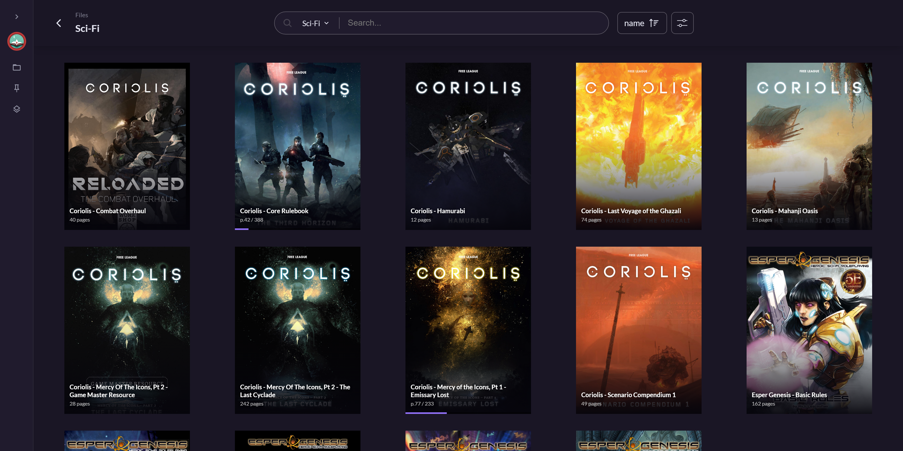
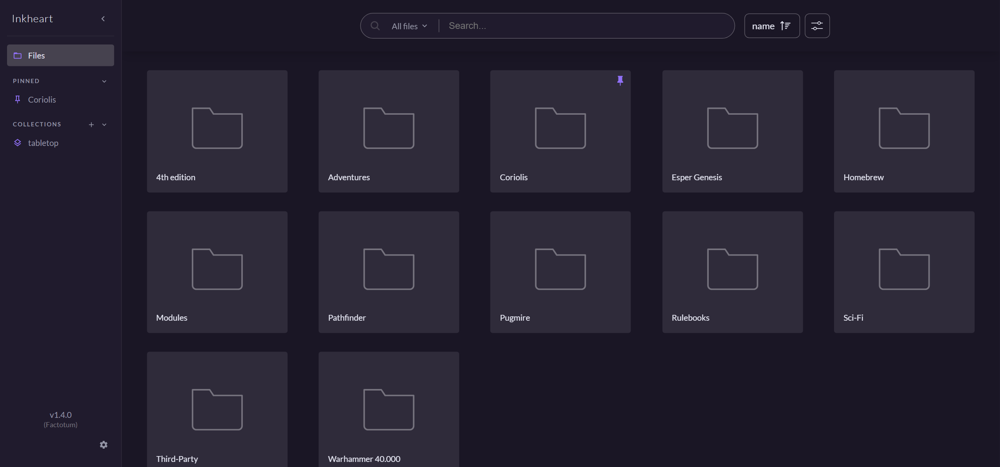
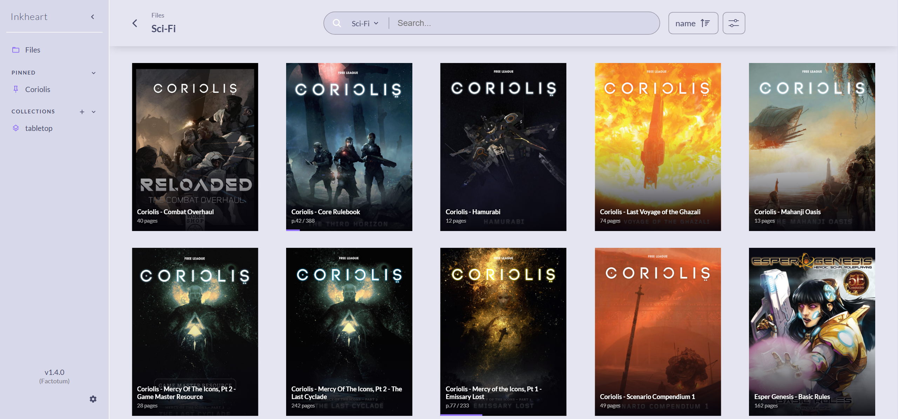
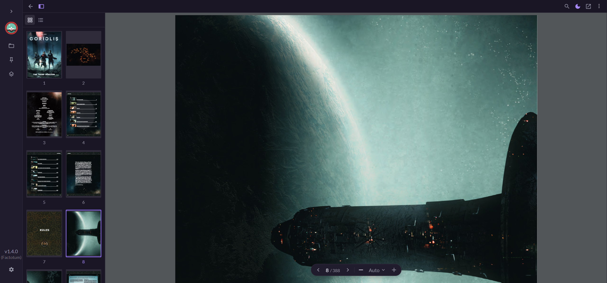
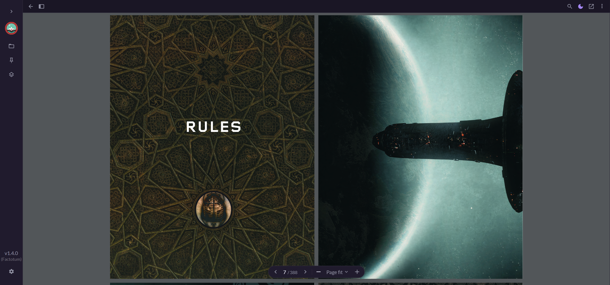
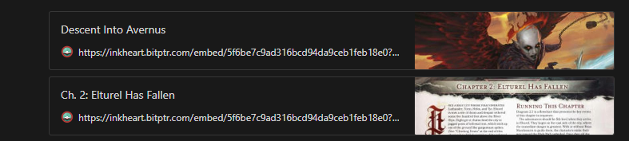

<div align="center">
  
  <h1>Inkheart</h1>
  <p><strong>Lightweight, self-hosted PDF & EPUB library indexer and web reader.</strong></p>

  <p>
    <a href="https://github.com"></a>
    </a>
    
    <a href="https://ko-fi.com/nystik"></a>
  </p>
</div>

<br>

<p align="center">
  
</p>

---

## 📖 About Inkheart

**Inkheart** is a minimalist, self-hosted digital library designed around one core philosophy: **your filesystem is the source of truth**. 

Instead of requiring an external database, complex schemas, or manual book metadata curation, Inkheart scans your media directory as an on-disk folder tree. It extracts high-resolution covers, compiles an instant full-text search index, and provides sleek, integrated web readers for both **PDF** and **EPUB** documents.

Inkheart is intentionally lightweight and focused. It is not an unwieldy comic/manga scraper or a full-blown OPDS manager — it does one thing exceptionally well: gives you a fast, beautiful way to read and search your documents on desktop, tablet, and mobile.

---

## ✨ Features

- 📁 **Filesystem-Driven Navigation** — Preserves your exact folder hierarchy without requiring a database.
- 📑 **Dual Native Web Readers**:
  - **PDF Reader**: Built on PDF.js with continuous scrolling, page spread modes, thumbnails, and outline navigation.
  - **EPUB Reader**: Built on epub.js with table-of-contents navigation, responsive page turns, keyboard shortcuts, and swipe gestures.
- 🔍 **Blazing Fast Full-Text Search** — Powered by [Tantivy](https://github.com/quickwit-oss/tantivy). Indexes content across PDF pages and EPUB chapters with outline/heading boost. Only re-indexes modified files (`mtime`).
- 🎨 **Theme Consistency** — Adaptive light and dark modes across the app and document reading canvas.
- 🔖 **Reading Progress Tracking** — Automatically remembers your current page/CFI location in `localStorage`.
- 📌 **Sidebar Pins & Collections** — Pin favorite folders to your sidebar or group documents into custom collections.
- 🔗 **Direct Page & Location Linking** — Link directly to any page or chapter (e.g. `/reader/:id?page=4`), with OpenGraph social preview cards.
- 📱 **Mobile & Tablet Optimized** — Responsive drawer sidebars, auto-collapsing toolbars, and touch navigation.
- 🐳 **Multi-Arch Docker Images** — Prebuilt for **AMD64** (x86_64) and **ARM64** (Raspberry Pi 4B+, Apple Silicon, ARM servers).
- 🔒 **Optional Authentication** — Simple drop-in Firebase Auth gate with account whitelisting.

---

## 🚀 Quickstart with Docker Compose

Create a `docker-compose.yml` file:

```yaml
services:
  inkheart:
    image: ghcr.io/<your-github-username>/inkheart:latest # Or build locally: build: .
    container_name: inkheart
    restart: unless-stopped
    ports:
      - "8080:8080"
    volumes:
      - /path/to/your/books:/media         # Your PDFs and EPUBs
      - /path/to/covers:/covers            # Extracted cover images
      - /path/to/thumbnails:/thumbnails    # OpenGraph preview thumbnails
      - /path/to/config:/config            # Search index, settings, and pins
    environment:
      - BIND_ADDR=0.0.0.0
      - BIND_PORT=8080
      - SCAN_INTERVAL=600                  # Filesystem re-scan interval in seconds
      - TEXT_INDEX_ENABLED=true            # Enable full-text search indexing
```

Ensure your storage directories exist:
```bash
mkdir -p /path/to/covers /path/to/thumbnails /path/to/config /path/to/your/books
```

Start the container:
```bash
docker compose up -d
```
Open **`http://localhost:8080`** in your browser.

> [!NOTE]
> On the first startup with a large collection, building the full-text search index may take a few minutes. Because `/config` is persisted, subsequent restarts will only scan for new or modified files.

---

## 🍓 Hosting on Raspberry Pi 4B

Inkheart runs great on a Raspberry Pi 4B (ARM64). Because the GitHub Actions workflow automatically builds native `linux/arm64` images to GitHub Container Registry, **you do not need to compile Rust on the Pi**:

1. On your Pi, create a folder for Inkheart:
   ```bash
   mkdir -p ~/inkheart/books ~/inkheart/covers ~/inkheart/thumbnails ~/inkheart/config
   cd ~/inkheart
   ```

2. Create `docker-compose.yml` using the configuration above (setting `image: ghcr.io/<your-username>/inkheart:latest`).
3. Run:
   ```bash
   docker compose up -d
   ```
4. Access Inkheart from any device on your local network: `http://<your-pi-ip>:8080`.

---

## 🛠️ GitHub Actions CI/CD

This repository includes an automated multi-arch GitHub Actions workflow ([`.github/workflows/docker.yml`](.github/workflows/docker.yml)) that:
- Automatically builds for **`linux/amd64`** and **`linux/arm64`**.
- Publishes the container image to **GitHub Container Registry (`ghcr.io`)** on every push to `main` or release tag.
- Uses BuildKit layer caching for lightning-fast subsequent builds.

To use it with your own GitHub account:
```bash
git init
git add .
git commit -m "Initial commit with EPUB support & GitHub Actions"
git remote add origin https://github.com/<your-username>/inkheart.git
git branch -M main
git push -u origin main
```
The GitHub Action will automatically trigger, build the multi-arch image, and publish it under your GitHub Packages tab.

---

## ⚙️ Configuration Reference

Inkheart supports configuration through environment variables or an `inkheart.toml` file.

| Environment Variable | Description | Default |
|---|---|---|
| `MEDIA_DIR` | Directory containing your PDF and EPUB files | `/media` |
| `IMAGE_DIR` | Directory where book covers are cached | `/covers` |
| `THUMBNAIL_DIR` | Directory for on-demand page preview thumbnails | `/thumbnails` |
| `CONFIG_DIR` | Directory storing user data, pins, collections, and search index | Parent dir of `CONFIG_PATH` |
| `CONFIG_PATH` | Optional path to an `inkheart.toml` file | `./inkheart.toml` |
| `BIND_ADDR` | Network address the server binds to | `127.0.0.1` (`0.0.0.0` in Docker) |
| `BIND_PORT` | HTTP port | `8080` |
| `SCAN_INTERVAL` | Filesystem scan interval for changes (in seconds) | `600` (10 min) |
| `COVER_WIDTH` | Width in pixels for extracted cover art | `900` |
| `THUMBNAIL_WIDTH` | Width in pixels for preview thumbnails | `300` |
| `TEXT_INDEX_ENABLED` | Enables full-text search indexing | `true` |
| `BASE_PATH` | Subdirectory path prefix (e.g. `/books`) when behind reverse proxy | `""` |
| `FIREBASE_CONFIG_PATH` | Path to `firebase.json` for optional Google/email auth | `./firebase.json` |
| `FIREBASE_WHITELIST` | Path to text file with whitelisted user IDs | None |
| `TELEMETRY_ENABLED` | Anonymous installation ping | `true` |

---

## 🌐 Reverse Proxy Subdirectory

To serve Inkheart from a subpath (e.g., `https://example.com/library/`):

1. Set `BASE_PATH=/library` in your container environment.
2. In your Nginx configuration:
   ```nginx
   location /library/ {
       proxy_pass http://127.0.0.1:8080/;
       proxy_set_header Host $host;
       proxy_set_header X-Real-IP $remote_addr;
       proxy_set_header X-Forwarded-For $proxy_add_x_forwarded_for;
       proxy_set_header X-Forwarded-Proto $scheme;
   }
   ```

---

## 🏗️ Architecture

```
inkheart/
├── backend/            # Rust Actix-Web server
│   ├── indexer/        # Filesystem scanner, PDF/EPUB cover & chapter extraction
│   │   └── text_search/# Tantivy search engine, mtime change tracking, HTML parser
│   ├── server/         # REST API routes, auth extractor, static file serving
│   └── pdfium/         # Native PDFium bindings for PDF rendering
├── frontend/           # Svelte 4 SPA
│   ├── src/ui/         # NativePdf (PDF.js) & EpubReader (epub.js) components
│   └── src/stores/     # LocalStorage reading progress, themes, collections, pins
└── docker/             # Multi-stage multi-arch Dockerfile (cargo-chef + node + distroless)
```

---

## 📸 Screenshots

<p align="center">
  
  
  
</p>
<p align="center">
  
  
</p>

---

## 📄 License

Inkheart is licensed under the [Apache License, Version 2.0](LICENSE).
Logo and branding assets are copyright of their respective authors.
